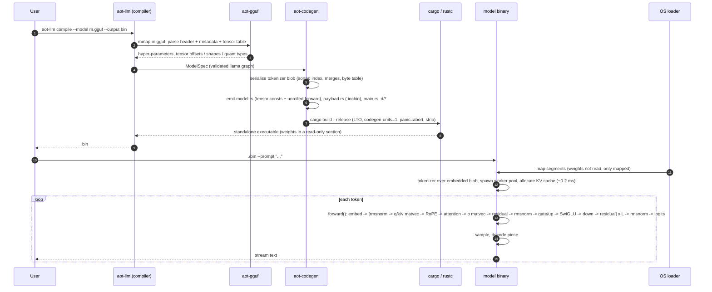

# aot-llm

[](https://github.com/p10node/aot-llm/actions/workflows/ci.yml)

Ahead-of-time compiler that turns a quantized GGUF model into **one native executable**, or into **one C library** (`--lib`): no runtime, no Python, no interpreter, no model file to load. The weights are placed in a read-only section of the binary, the OS maps them lazily, and the first forward pass starts about **0.2 ms** after `main()`. Llama, Qwen2/2.5, Qwen3 and Phi-3 models are supported.

```text
$ aot-llm compile --model tinyllama-1.1b-chat-v1.0.Q4_K_M.gguf --output ./tinyllama_bin
[1/4] parsed tinyllama-1.1b-chat-v1.0.Q4_K_M.gguf (GGUF v3, 201 tensors, 23 metadata keys)
      tinyllama | llama | 1.100B params | MOSTLY_Q4_K_M | dim 2048 hidden 5632 layers 22 heads 32/4 vocab 32000
[2/4] tokenizer: spm 32000 tokens, chat template: zephyr, blob 613.4 KB
[3/4] generated project in ./tinyllama_bin.build (22 layers unrolled, weights embedded)
[4/4] cargo build --release ...
done: ./tinyllama_bin (642.3 MB) in 10.8s

$ ./tinyllama_bin --prompt "The capital of France is" -n 32
 Paris.

2. B.C. The capital of ancient Rome was Rome.
[aot-llm] startup 0.190 ms (threads 0.111, tokenize 0.076) | prompt 6 tok (97 tok/s) | gen 32 tok (107 tok/s) | peak RSS 608 MB | 8 threads | neon+dotprod
```

The output is byte-for-byte identical to llama.cpp (via Ollama) for the same GGUF under greedy decoding.

## Where it wins, and where it does not

aot-llm is about **first-response latency and packaging**, not raw throughput. Same GGUF, same Apple M1 Pro, 8 threads (details in [`docs/benchmarks/`](docs/benchmarks/README.md)):

| | aot-llm | Ollama / llama.cpp |
|---|---|---|
| process start → ready to decode | **0.2–0.8 ms** | 0.5–2.8 s model load, and the server must already be running |
| chat reply with a fixed system prompt, first token (warm) | **90–160 ms** (baked KV prefix, CPU), **64–74 ms** (Metal) | ~500–780 ms per request (CPU), ~470 ms (Metal) |
| cold first token (nothing in the page cache) | 0.6–0.7 s | 1.3–4.6 s |
| resident memory | 614–773 MiB | 766–1586 MiB plus ~40 MiB of server/app |
| decode, CPU | **113–128 tok/s** | 86–117 tok/s |
| decode, GPU (`--gpu metal`) | 92–106 tok/s | 139–150 tok/s (Metal) |
| long prompt evaluation | 200–260 tok/s (CPU), **550–750 tok/s** (Metal) | 410–510 tok/s |
| process start → ready, GPU | ~25–30 ms (Metal device, kernels from the OS cache, weights mapped) | 0.5–0.8 s model load |
| deployment | one file, no runtime, no daemon; copy and run; static Linux cross-build | install Ollama, pull the model, keep a server up |
| models | `llama`, `qwen2`, `qwen3`, `phi3`, `gemma3` architectures, 9 tensor types | every architecture and quantization |

**Good fit:** command-line tools, agents that call a model many times for short answers, edge / serverless / cron jobs where a process spawns, answers and exits, embedding a model in an application (`--lib` gives a static or shared library with a C API; see [`examples/`](examples/)).

**Poor fit:** multi-user chat servers, very long prompts (RAG, documents) on the CPU, machines whose GPU is not an Apple one (only Metal is supported). vLLM and friends solve a different problem (batched GPU serving, cold starts of tens of seconds) and are not comparable for one process answering one request.

## What it does

* **Zero runtime overhead.** The generated program depends only on `std`. Argument parsing, tokenizer, kernels, sampler: all compiled into one static binary (`opt-level=3`, fat LTO, one codegen unit, `panic=abort`, stripped).
* **Zero-copy weights.** The tensor data section of the GGUF file is copied verbatim into a private read-only section of the executable with the assembler's `.incbin` directive. The loader `mmap`s it like any other segment, so starting the binary costs no I/O; pages are faulted in on first touch. A `--sidecar` mode keeps the weights in a separate file that the binary `mmap`s at startup.
* **Static code generation.** The compiler reads the model graph from GGUF metadata and emits `model.rs`: a tensor table with byte offsets, and a `forward()` whose per-layer code is unrolled with the kernel for each tensor's quantization type chosen at compile time (`matvec_q4_k`, `matvec_q6_k`, ...). Architecture variations (Qwen2's q/k/v biases, Qwen3's per-head q/k norms, the NEOX RoPE layout) are resolved at compile time too: the generated block only contains the operators the model has. There is no graph interpreter.
* **SIMD kernels** for Q4_0, Q5_0, Q8_0, Q4_K, Q5_K, Q6_K, F16, BF16 and F32 weights: NEON (with `sdot` when available) on ARM64, AVX2 + FMA (+ F16C) on x86_64, scalar fallback. The implementation is picked once at startup, so a binary runs on any CPU of its architecture.
* **Batched prompt processing.** Prompt tokens go through the model in chunks of up to 64 (`--batch`); each weight row is read once per chunk and multiplied against four activations at a time by 1x4 micro-kernels, so prompt evaluation is compute-bound rather than memory-bound. Results are bit-identical to token-by-token evaluation.
* **Compile-time KV prefix cache.** `aot-llm compile --system "..."` evaluates the system prompt at build time and embeds its key/value cache in the binary; a chat prompt with that system prompt skips straight to the user turn.
* **Conversations across processes.** `--save-kv FILE` writes the tokens and KV cache of a run; `--load-kv FILE` continues it (with `--chat`: as the next user turn), so a multi-turn dialogue driven by separate process invocations only ever evaluates the new turn. The C API has `aot_ctx_save` / `aot_ctx_load` and `aot_generate` continues the conversation held in a context.
* **Output constraints for tools.** `--stop TEXT` ends generation before a string (held back until it is known not to be one), `--choices a,b,c` restricts the answer to exactly one of the given strings by masking the logits along a token trie: classifiers and routers that never need parsing. Both are in the C API too.
* **Background prefault.** At startup worker threads page the weights in (`madvise` + page touch) while the main thread tokenizes, which shortens cold first-token latency. `--no-prefetch` turns it off.
* **Single-binary output.** `aot-llm compile` writes a standalone Cargo project and builds it; cross-compiling to `x86_64-unknown-linux-musl` from macOS produces a static ELF.
* **Library output.** `aot-llm compile --lib` produces `lib<name>.a` (or `--lib shared`: `.dylib` / `.so`) plus `aot_llm.h`: open the model, tokenize, evaluate, read logits, sample, or call one `aot_generate` with a token callback. The weights are embedded the same way, so an application links the model like any other library and still pays nothing at startup. See [Library mode](#library-mode-c-api).
* **Optional Metal backend.** `aot-llm compile --gpu metal` adds a GPU path for Apple Silicon. The weights section of the executable is handed to Metal without a copy (unified memory), the activation buffers and the KV cache are shared between CPU and GPU, and a decode step is one command buffer of eight kernel dispatches per layer (RoPE, the SwiGLU product and the residual adds are fused into the quantized matrix-vector kernels). Prompt batches run as a simdgroup-matrix GEMM. The frameworks are loaded with `dlopen`, so the binary still links only `libSystem`, runs on the CPU with `--device cpu` and falls back to it when no GPU is available. The kernels are embedded as source and compiled by the system once per machine (cached afterwards).

## Quick start

Requirements: Rust 1.98+ (the kernels use `vdotq_s32`), a GGUF of a supported architecture: Llama (TinyLlama, Llama 2/3/3.2, Mistral 7B, ...), Qwen2/2.5, Qwen3 or Phi-3 (4k-context variants).

```bash
git clone https://github.com/p10node/aot-llm && cd aot-llm
cargo build --release

# Inspect what will be compiled
./target/release/aot-llm inspect ./Llama-3.2-1B-Instruct-Q4_K_M.gguf

# Compile (about 10-15 s on an M1 Pro; the GGUF is embedded, not copied)
./target/release/aot-llm compile --model ./Llama-3.2-1B-Instruct-Q4_K_M.gguf --output ./llama32

# Optional: bake the KV cache of a fixed system prompt into the binary (two build passes)
./target/release/aot-llm compile --model ./Llama-3.2-1B-Instruct-Q4_K_M.gguf --output ./llama32 \
    --system "You are a concise assistant. Answer in one short paragraph."

# Optional: also compile the Metal GPU path (macOS, Apple Silicon); the binary then uses the GPU by default
./target/release/aot-llm compile --model ./Llama-3.2-1B-Instruct-Q4_K_M.gguf --output ./llama32_gpu --gpu metal
./llama32_gpu --prompt "The capital of France is" -n 32              # --device cpu switches back

# Run
./llama32 --prompt "The capital of France is" -n 32
./llama32 --chat --prompt "Write one sentence about the moon." --temp 0.7
./llama32 --chat --system "You are a concise assistant. Answer in one short paragraph." --prompt "Why is the sky blue?"   # uses the baked prefix
./llama32 --info

# Qwen3 (answers directly by default; --think lets it reason first) and Qwen2.5
./target/release/aot-llm compile --model ./Qwen3-0.6B-Q4_K_M.gguf --output ./qwen3 --gpu metal
./qwen3 --chat --prompt "Write one sentence about the moon."
./target/release/aot-llm compile --model ./qwen2.5-0.5b-instruct-q4_k_m.gguf --output ./qwen25

# A C library instead of an executable (see examples/c/main.c, examples/python/)
./target/release/aot-llm compile --model ./Qwen3-0.6B-Q4_K_M.gguf --output ./libqwen3 --lib --name qwen3
cc -O2 examples/c/main.c -I./libqwen3 ./libqwen3/libqwen3.a -o chat && ./chat "Why is the sky blue?"

# Tools: constrained answers, stop strings, conversations across processes
./qwen3 --chat --prompt "Is this review positive? 'Broke after two days.'" --choices positive,negative,neutral
git diff | ./qwen3 --chat --system "One-line commit subject." --stop '\n'
./qwen3 --chat --prompt "My name is Pierre." --save-kv talk.kv
./qwen3 --chat --prompt "What is my name?" --load-kv talk.kv --save-kv talk.kv   # evaluates only the new turn
```

Generated binary options:

```text
-p, --prompt TEXT        Prompt text (reads stdin when omitted)
-n, --max-tokens N       Maximum tokens to generate [default: 128]
    --temp F             Sampling temperature, 0 = greedy [default: 0]
    --top-k N            Top-k filter, 0 = off [default: 40]
    --top-p F            Nucleus sampling threshold [default: 0.95]
    --repeat-penalty F   Repetition penalty, 1 = off [default: 1.0]
    --seed N             RNG seed [default: 42]
-c, --ctx N              Context length [default: prompt + max-tokens]
-t, --threads N          Worker threads [default: min(cores, 8)]
-b, --batch N            Prompt tokens per batched step, 1 = token by token [default: 64]
    --chat               Wrap the prompt in the model's chat template (llama3 / zephyr / chatml / qwen3 / llama2 / mistral / gemma)
    --system TEXT        System prompt for --chat
    --think              Let a Qwen3 model think before answering (--chat)
    --stop TEXT          Stop when the output contains TEXT (repeatable; \n escapes allowed)
    --choices A,B,C      Answer with exactly one of the given strings (also --choice TEXT, repeatable)
    --save-kv FILE       After generating, write the tokens and KV cache of the whole run to FILE
    --load-kv FILE       Continue a saved run: the prompt is appended (--chat: as the next user turn)
    --no-bos             Do not prepend the BOS token
    --no-prefetch        Do not page in the weights from background threads at startup
    --no-prefix-cache    Ignore the compile-time KV prefix cache
    --kernels NAME       auto | scalar | neon | neon-dotprod | avx2
    --device NAME        auto | cpu | gpu (gpu needs a binary built with --gpu) [default: auto]
    --weights PATH       Sidecar weights file (sidecar builds only)
    --show-special       Print special tokens
    --tokens             Print token ids instead of text
    --dump-logits        Print the logits of the last prompt token and exit
-q, --quiet              Do not print statistics to stderr
    --info               Print model information and exit
```

Compiler options (`aot-llm compile --help`): `--lib [static|shared]` (build a model library with the C API instead of an executable; `--output` is then a directory), `--symbol-prefix PFX` (prefix the library's C symbols and header names so several models can be linked into one program), `--gpu metal` (compile the Metal backend in, macOS only), `--system TEXT` / `--prefix TEXT` (bake a KV prefix cache), `--target <triple>`, `--native` (`-C target-cpu=native`), `--sidecar`, `--emit-only` (generate the project without building), `--build-dir`, `--name`, `-j`, `-q`.

Debugging: `AOT_DEBUG_COMPARE=1 ./bin ...` re-evaluates the prompt token by token and reports the first KV-cache divergence from the batched path; `--dump-logits` prints the logits of the last prompt token.

## How it works



The static pipeline emitted for every model is

```text
tokens -> embedding -> [RMSNorm -> Attention(GQA, RoPE, KV cache) -> + -> RMSNorm -> SwiGLU FFN -> +] x N -> RMSNorm -> logits -> sampler
```

Qwen2 adds bias vectors to the q / k / v projections and Qwen3 a per-head RMSNorm of q and k before RoPE; both rotate `(i, i + rot_dim / 2)` pairs (the GPT-NeoX layout) instead of adjacent elements. Phi-3 stores q / k / v as one `attn_qkv` tensor and gate / up as one `ffn_up` tensor; the compiler addresses the parts as row ranges of the same bytes, so the generated code is the plain block. Gemma 3 scales the embedding by `sqrt(dim)`, normalises q and k per head, uses GeGLU, normalises the attention and FFN outputs before the residual adds, and attends over a sliding window of 512 / 1024 positions in five of every six layers with a separate RoPE base (10000, unscaled) while the sixth layer sees the whole context (base 1e6, linear scaling on the 4B+ models); the compiler emits the window and the RoPE table per layer. The code generator emits exactly the operators the architecture has, on the CPU and on the GPU (where the NEOX models rotate in a separate dispatch because the pairs are half a head apart, and the biases are added in the epilogue of the matrix kernels).

Prompt batches run the matrix products over dynamically scheduled row blocks and the element-wise work (RMSNorm, SwiGLU, residual adds, activation quantization) over the pool as well, with the same per-element arithmetic as the token-by-token path, so batched and single evaluation stay bit-identical.

Per matmul, the f32 activation vector is quantized once to Q8_0 (for Q4_0/Q8_0 weights) or Q8_K (for K-quants) and every output row is an integer dot product scaled back to f32, the same scheme ggml uses, so results match llama.cpp. During decoding the q/k/v projections form one parallel region and gate/up another; rows are handed out in dynamic chunks; attention is parallel over heads. The thread pool keeps workers hot between the few hundred small parallel regions of a decode step.

### The Metal path

With `--gpu metal` the generated `model.rs` also contains `forward_gpu` / `forward_batch_gpu`, which encode the same operator sequence into one Metal command buffer per step through `rt/metal.rs`:

* The weights section is placed in `__DATA` (page aligned) and re-mapped `MAP_SHARED` from the executable file at startup, then wrapped with `newBufferWithBytesNoCopy`. A private mapping would be copied page by page the first time the GPU wires it (hundreds of milliseconds), and wired copies of `__TEXT` pages make the CPU fault on them afterwards; the shared mapping has neither problem and shares the page cache with the loader's own mapping. Mapping 636 MB costs about 15–25 ms on first use.
* The activation buffers and the KV cache of `State` are page-aligned anonymous mappings wrapped the same way, so the CPU embedding lookup, the GPU transformer blocks, the compile-time KV prefix and the sampler all work on one copy of the data.
* A decode step is eight dispatches per layer: RMSNorm, the `q`, `k`, `v` projections (RoPE applied in the epilogue of `q` and `k`, `k` and `v` written straight into the cache), attention (one threadgroup per head, online softmax over blocks of 32 positions), `wo` (residual add fused), RMSNorm, the fused `gate`/`up`/SwiGLU product and `down` (residual add fused). The matrix-vector kernels are bound by their vector loads, so RMSNorm is kept as its own 12 µs kernel: folding it into the products (a second vector read per simdgroup) measured 2–3x slower. Prompt batches use a 32x32x32-tile GEMM on the simdgroup matrix units with the weights dequantized once per tile.
* The Objective-C runtime and `Metal.framework` are resolved with `dlopen`/`dlsym` on first use; nothing is linked, and `--device cpu` never loads them. The kernel source (`shaders.metal`) is embedded and compiled by the system Metal compiler the first time a binary runs on a machine (~0.3 s), then served from the OS shader cache (<1 ms).

The GPU kernels use f32 activations and dequantize weights on the fly (as ggml's Metal path does) instead of the CPU path's Q8 activations, so GPU output is not bit-identical to the CPU path or to llama.cpp's CPU output; it is closer to exact f32 arithmetic (kernel error ~1e-6 relative against an f64 reference versus ~1e-3 for the Q8 path), and greedy generations agree in practice.

Prompt tokens are processed by `forward_batch` in chunks: every weight row is loaded once per chunk and the 1x4 micro-kernels decode each quantized block once for four activations, so prompt evaluation runs several times faster than decoding. With `--system`, the compiler builds the binary twice: pass 1 evaluates the system prefix with the final kernels and writes its KV cache, pass 2 embeds that blob in a read-only section; at run time a prompt whose tokens start with the baked prefix loads the rows with a memcpy and evaluates only the user turn.

### Repository layout

| crate                | role                                                                                                                                                                                |
|----------------------|-------------------------------------------------------------------------------------------------------------------------------------------------------------------------------------|
| `crates/aot-gguf`    | GGUF v2/v3 parser (header, metadata, tensor descriptors), memory-mapped access, in-memory writer for tests                                                                          |
| `crates/aot-kernels` | the runtime: quant layouts, SIMD matvec kernels, RMSNorm / RoPE / attention, thread pool, tokenizer, sampler, CLI driver, C API (`capi.rs`), Metal backend (`metal.rs`, `shaders.metal`). Copied verbatim into every generated project as `src/rt/` |
| `crates/aot-codegen` | graph extraction (`ModelSpec`), tokenizer blob builder, Rust project emitter (binary or library), the C header (`aot_llm.h`), cargo driver                                             |
| `crates/aot-llm`     | the `aot-llm` CLI: `compile`, `inspect`, `tokenize`                                                                                                                                 |
| `examples/`          | `c/main.c` (the C API), `python/` (ctypes binding), `commit-msg/` (a git commit-message generator in one binary)                                                                     |

## Library mode (C API)

`aot-llm compile --lib` builds the same generated project as a `staticlib` (`--lib shared`: `cdylib`) whose entry points are the functions of [`aot_llm.h`](crates/aot-codegen/src/aot_llm.h):

```c
aot_model *m = aot_open(NULL);                 /* weights mapped, tokenizer ready, threads up: ~1 ms warm */
aot_ctx *c = aot_ctx_new(m, 512, 0);           /* one sequence, 512-token context */
aot_generate_params p = aot_generate_default_params();
p.chat = 1; p.system = "You are a concise assistant."; p.max_tokens = 96;
aot_generate(c, "Why is the sky blue?", 0, &p, print_piece, NULL);   /* streams pieces to the callback */

uint32_t ids[64];
int32_t n = aot_tokenize(m, "The capital of France is", 0, -1, 1, ids, 64);
aot_ctx_reset(c);
aot_eval(c, ids, n, 1);
const float *logits = aot_logits(c);           /* n_vocab floats */
```

The model is a process-wide singleton (the library *is* the model); contexts and samplers are plain handles. Evaluations are serialised internally, so contexts can be driven from any thread. `aot_generate` appends to its context, so calling it again continues the conversation; `aot_ctx_save` / `aot_ctx_load` move a conversation between processes; `aot_generate_params.stop` and `.choices` are the CLI's `--stop` / `--choices`. A compile-time KV prefix (`--system`) is honoured by `aot_eval` when a fresh context starts with the baked tokens. `--gpu metal` works the same way as for executables (`aot_model_params.device`). Link with `cc app.c libmodel.a` on macOS and `cc app.c libmodel.a -lpthread -ldl -lm` on Linux; the compiler prints the line. To link several models into one program build each with `--symbol-prefix qwen3_` (and so on): the symbols and the header's identifiers get the prefix.

[`examples/c/main.c`](examples/c/main.c) is a complete program, [`examples/python/aot_llm.py`](examples/python/aot_llm.py) a ctypes binding with the same surface (`Model.generate`, streaming, `save` / `load`, `choices`, `stop`), and [`examples/commit-msg/`](examples/commit-msg/) shows the executable side: a commit-message generator with the instructions baked in, usable as a `prepare-commit-msg` hook.

## Benchmarks

The tables below are the initial measurements of the first release. Every later optimisation step is measured with `scripts/bench.py` and recorded under [`docs/benchmarks/`](docs/benchmarks/README.md) (one file per step, cold/warm/chat columns, plus the Ollama reference). Summary of the steps so far (Apple M1 Pro, 8 threads, medians; "chat" = 88-token prompt with a 66-token system prompt for TinyLlama, 70/55 for Llama 3.2):

| step | TinyLlama Q4_K_M chat first token | Llama-3.2-1B chat first token | TinyLlama decode | Llama-3.2-1B decode |
|---|---|---|---|---|
| baseline (`bf6f95b`) | 685 ms | 777 ms | 104 tok/s | 61–87 tok/s |
| batched prompt + 1x4 micro-kernels | 424 ms | 488 ms | 116 tok/s | 83 tok/s |
| + background prefault | 375 ms (cold first token 652 → 642 ms) | 302 ms (1030 → 711 ms) | 114 tok/s | 93 tok/s |
| + fused q/k/v, dynamic chunks, `fcvt` scales | 436 ms | 298 ms | **128 tok/s** | **113 tok/s** |
| + baked system-prompt KV cache (`--system`) | **164 ms** | **90 ms** | 128 tok/s | 113 tok/s |
| Metal backend (`--gpu metal`), same prompts on the GPU | **64 ms** (+30 ms Metal start-up) | **74 ms** (+30 ms) | 106 tok/s | 92 tok/s |

Decode is now at llama.cpp's CPU speed (117 / 86 tok/s in Ollama), and a chat reply with a baked system prompt starts in about 100 ms instead of 700–1000 ms. The Metal path trades ~30 ms of start-up (loading the frameworks, creating the device, kernels from the OS shader cache, wiring the weights) for prompt evaluation at 550–750 tok/s on 300-token prompts (CPU: 200–260), chat first tokens of 64–74 ms and decoding at 92–106 tok/s on these 1B models, slightly below the CPU path on TinyLlama and a little above it on Llama 3.2 (the GPU kernels reach 75–107 GB/s against llama.cpp's ~115 GB/s). It is the better choice for long prompts and for models the CPU cannot keep up with; details in [`docs/benchmarks/07-metal.md`](docs/benchmarks/07-metal.md). The baseline tables that follow are kept for reference.

Machine: Apple M1 Pro (8 performance + 2 efficiency cores, 16 GB), macOS, Rust 1.99. Prompt: 11-13 tokens, 64 generated tokens, greedy, warm page cache, 8 threads, median of 3 runs on an otherwise idle machine. Ollama 0.34.4 with its bundled llama.cpp `llama-server`, same GGUF files imported with `ollama create`, measured through `/api/generate` (`raw: true`); "cold" means after `ollama stop`.

### Startup latency

|                                                       | TinyLlama-1.1B Q4_K_M                     | Llama-3.2-1B-Instruct Q4_K_M |
|-------------------------------------------------------|-------------------------------------------|------------------------------|
| **aot-llm** process start -> ready to decode          | **0.19 ms** (threads 0.11, tokenize 0.08) | **0.27 ms**                  |
| aot-llm time to first token (warm cache)              | 120 ms (prompt eval)                      | 110 ms                       |
| Ollama cold request, CPU (model load / total)         | 1.57 s / 2.33 s                           | 2.84 s / 4.61 s              |
| Ollama cold request, Metal GPU (model load / total)   | 0.54 s / 1.34 s                           | 0.83 s / 1.48 s              |
| Ollama warm request overhead (model already resident) | ~0.58 s total for 64 tokens               | ~0.78 s                      |

"Ready" for aot-llm means the weights are mapped, the tokenizer has encoded the prompt, the worker pool is up and the KV cache is allocated. Nothing is read from disk at startup; the first forward pass pages the weights in (about 0.6 s on a cold page cache for 640 MB, like any mmap-based loader).

### Memory

|                                                      | TinyLlama-1.1B Q4_K_M | Llama-3.2-1B-Instruct Q4_K_M |
|------------------------------------------------------|-----------------------|------------------------------|
| **aot-llm** peak RSS (whole process, incl. KV cache) | **608 MiB**           | **770 MiB**                  |
| aot-llm binary on disk                               | 642 MiB               | 776 MiB                      |
| Ollama `llama-server` RSS, CPU mode                  | 798 MiB               | 1586 MiB                     |
| Ollama `llama-server` RSS, GPU mode                  | 766 MiB               | 1420 MiB                     |
| Ollama `ollama serve` + app processes                | ~40 MiB               | ~40 MiB                      |

aot-llm's RSS is essentially the touched weight pages (636 / 763 MiB of tensor data) plus a context-sized KV cache; there is no second copy of anything.

### Throughput (CPU, 8 threads unless noted)

|                                              | TinyLlama-1.1B Q4_K_M | TinyLlama-1.1B Q4_0 | Llama-3.2-1B Q4_K_M |
|----------------------------------------------|-----------------------|---------------------|---------------------|
| **aot-llm** decode                           | **107 tok/s**         | 85 tok/s            | **86 tok/s**        |
| aot-llm prompt eval (token by token)         | 107 tok/s             | 90 tok/s            | 100 tok/s           |
| Ollama / llama.cpp CPU decode                | 117 tok/s             | -                   | 86 tok/s            |
| Ollama / llama.cpp CPU prompt eval (batched) | 510 tok/s             | -                   | 412 tok/s           |
| Ollama / llama.cpp Metal GPU decode          | 150 tok/s             | -                   | 139 tok/s           |

Decode speed is within ~10% of llama.cpp's CPU path. Prompt evaluation is the known gap: aot-llm processes prompt tokens one at a time (matrix-vector), while llama.cpp batches them into matrix-matrix products. Using 10 threads on this machine (i.e. the two efficiency cores) drops throughput to ~20 tok/s because every parallel region waits for its slowest worker, hence the default cap of 8.

**vLLM** was not benchmarked: it needs a CUDA GPU, and it is a serving engine (continuous batching, paged attention) whose cold start loads weights into GPU memory and captures CUDA graphs, which takes seconds to minutes. It is the wrong tool for the "start a process, answer, exit" use case this project targets, which is why the comparison above is against Ollama.

## Correctness

* `cargo test --workspace` runs
  * unit tests for the GGUF parser, f16 conversion, quantizers, pool, ops, sampler and tokenizer pre-tokenizers;
  * `crates/aot-kernels/tests/dots.rs`: every SIMD dot product (NEON, NEON+dotprod, AVX2, AVX2+F16C) against the scalar reference and a float reference, for every supported weight type;
  * `crates/aot-kernels/tests/metal.rs` (macOS): every Metal kernel against the CPU operators: the matrix product for all nine weight formats (single vector, batched, partial tiles, residual accumulation), the fused RoPE / gate / RMSNorm variants, RMSNorm, RoPE, attention for 64- and 128-wide heads, SwiGLU; skipped when no Metal device exists;
  * `crates/aot-codegen/tests/tokenizer_blob.rs`: SentencePiece and byte-level BPE round trips through the serialised blob;
  * `crates/aot-llm/tests/e2e.rs`: builds a tiny random GGUF for each architecture (`llama`, `qwen2` with biases, `qwen3` with q/k norms and `q_dim > dim`, `phi3` with fused tensors) that uses all nine weight types, compiles it with the CLI, runs the binary with `--dump-logits` and compares against an f32 reference forward pass (max error 0.0000 on the logits); on macOS it also compiles each model with `--gpu metal` and checks the GPU logits (single-token and batched prompt paths) against the unquantized reference. Further tests compile the model with `--lib`, build a C client against `aot_llm.h` with the system C compiler and check tokens, logits (batched, token by token, and after `aot_ctx_save` / `aot_ctx_load`), `aot_generate` and `choices`; and exercise `--stop`, `--choices` and the `--save-kv` / `--load-kv` continuation (bit-identical to evaluating the whole prompt at once).
* The same suite runs in CI on Linux x86_64 (AVX2) and macOS Apple Silicon (NEON + Metal), plus a musl cross-build ([`.github/workflows/ci.yml`](.github/workflows/ci.yml)).
* Tokenization was checked against llama.cpp ids for the three vocabularies (e.g. Llama 3 `"Hello world"` -> `[128000, 9906, 1917]`, TinyLlama -> `[1, 15043, 3186]`; Qwen uses the Llama 3 regex with single-digit numbers).
* Greedy generations of the real models match Ollama/llama.cpp token for token: TinyLlama-1.1B, Llama-3.2-1B, Qwen2.5-0.5B-Instruct (Q8_0 and Q4_K_M, the latter mostly `q5_0`) on CPU and Metal, Qwen3-0.6B on CPU and Metal for raw prompts (the chat prompt of this 0.6B model is a low-margin case where llama.cpp's own CPU and Metal backends disagree with each other as well), Phi-3-mini-4k-instruct Q4_K_M (38-token chat reply identical to llama.cpp's CPU output; its Metal output differs from both, as llama.cpp's own does), Gemma-3-1b-it and Gemma-3-4b-it Q4_K_M (raw prompts identical to llama.cpp's CPU output; the chat reply of the 1B model is identical to llama.cpp's *Metal* output and differs from its CPU output, whose GELU goes through ggml's f16 lookup table while aot-llm evaluates the tanh form exactly).
* The AVX2 kernels were validated by running the test suite under `docker run --platform linux/amd64`; a TinyLlama binary cross-compiled to `x86_64-unknown-linux-musl` runs in the same container (`avx2+f16c`).

## Cross-compiling

```bash
rustup target add x86_64-unknown-linux-musl
aot-llm compile --model m.gguf --output ./m_linux --target x86_64-unknown-linux-musl
file ./m_linux   # ELF 64-bit LSB pie executable, x86-64, static-pie linked, stripped
```

For `*-musl` targets the generated project links with `rust-lld` and the self-contained musl CRT, so no cross toolchain is needed. Other targets need a linker for that platform (`.cargo/config.toml` in the generated project is the place to set it).

## Supported models and limits

* Architectures as written by `convert_hf_to_gguf.py`:
  * `llama`: Llama 1/2/3/3.1/3.2, TinyLlama, Mistral 7B, Vicuna, OpenLLaMA and other derivatives without biases. RoPE "normal" layout, grouped-query attention, RMSNorm, SwiGLU, tied or separate output head, Llama 3.x RoPE frequency factors, linear RoPE scaling.
  * `qwen2`: Qwen2 / Qwen2.5 (q/k/v biases, NEOX RoPE). The 0.5B models have `dim = 896`, so their `Q4_K_M` files are mostly `q5_0`, which is supported.
  * `qwen3`: Qwen3 dense models (per-head q/k RMSNorm, NEOX RoPE, explicit head size). `--chat` answers without thinking by default; `--think` keeps the thinking turn.
  * `phi3`: Phi-3 mini / medium with the plain 4k context (fused `attn_qkv` / `ffn_up` tensors, NEOX RoPE, `<|user|>` / `<|end|>` chat template). The 128k variants use LongRoPE (`rope_factors_long/short`) and are rejected; Phi-4-mini's tokenizer (`gpt-4o` pre-tokenizer) is not implemented.
  * `gemma3`: Gemma 3 1B / 4B / 12B / 27B text models (scaled embedding, q/k norms, post-norms, GeGLU, sliding-window layers with their own RoPE base, head size 256). The vision tower of the multimodal GGUFs is a separate file and is ignored; the sliding window keeps a full-size KV cache (no ring buffer), so memory grows with the context like a global layer's.
* Tensor types: `f32`, `f16`, `bf16`, `q4_0`, `q5_0`, `q8_0`, `q4_K`, `q5_K`, `q6_K` (covers `Q4_0`, `Q5_0`, `Q8_0`, `Q4_K_S/M`, `Q5_K_S/M`, `Q6_K`, `F16` files). `iq*`, `q2_K`, `q3_K`, `q4_1`, `q5_1` are rejected with a message naming the tensor.
* Tokenizers: SentencePiece (`llama`) and byte-level BPE (`gpt2` with the Llama 3, Qwen2 or GPT-2 pre-tokenizer). Chat templates: llama3, zephyr, chatml, qwen3, phi3, llama2, mistral, gemma.
* Single sequence, batch size 1, unix targets (the weight embedding uses `global_asm!`, memory mapping uses `mmap`). GPU: Metal on macOS / Apple Silicon only (`--gpu metal`), head sizes of 32, 64, 96 or 128.
* Not yet: KV-cache quantization, Phi-4 / Gemma 2 / MoE architectures, LongRoPE, CUDA / Vulkan backends.

`unsafe` is confined to SIMD intrinsics, the `.incbin` symbol and `mmap` views, the fork-join pool's lifetime-erased job pointer and disjoint-range writes, the Metal backend's `objc_msgSend` calls and the raw handles of the C API; each site is commented with its invariant.

## License

MIT or Apache-2.0, at your option.
